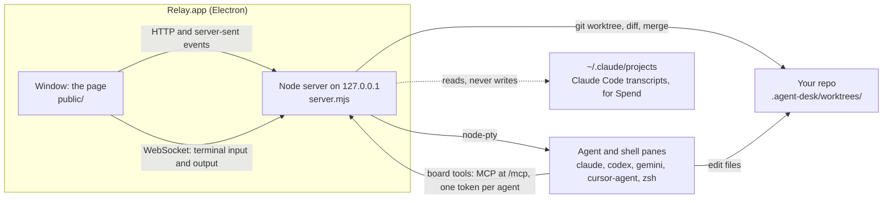

# Relay

**Delegate the work. Own the outcome.**

Multiple coding agents. Isolated workspaces. One place to review and ship.

A Mac app for running a team of coding agents side by side, like BridgeMind's BridgeSpace. Every pane is a
real terminal running the agent's own CLI, so Claude Code uses your normal Claude login and subscription.

[Download](https://github.com/aahannp/relay/releases/latest) ·
[Releases](https://github.com/aahannp/relay/releases) ·
[Issues](https://github.com/aahannp/relay/issues) ·
[Report a bug](https://github.com/aahannp/relay/issues/new) ·
[Verify a release](#verify-a-release) ·
[Website](https://aahannp.github.io/relay/)

Recorded from the real app (1.9.0 code) with a demo repo. The agents'
replies are scripted, so no model ran; the board, worktrees, edits and diff are real.

## Install

Download `Relay-<version>-arm64.dmg` from the [latest release](https://github.com/aahannp/relay/releases/latest),
open it and drag Relay into Applications. Or install from Terminal:

    curl -fsSL https://aahannp.github.io/relay/install.sh | bash

The installer ([docs/install.sh](docs/install.sh)) stops unless it's on macOS with Apple silicon, asks GitHub's
API for the latest release, downloads its DMG with curl into a temporary folder, mounts it read-only, stops
unless the app is closed, replaces `/Applications/Relay.app` with the copy inside and opens it. Files curl
downloads aren't quarantined, so macOS doesn't warn; that also means nothing checks the download, the script
included. [Verify a release](#verify-a-release) if you want to.

The DMG is signed ad-hoc (there's no Apple developer account), so the first time you open the copied app,
right-click it and choose Open (macOS 15+: System Settings → Privacy & Security → Open Anyway).

### Coming from Agent Desk?

Install Relay as above. Your board, chats and settings carry over automatically: Relay reads
`~/Library/Application Support/Agent Desk`. Afterwards you can delete Agent Desk.app. Don't run both at once.

Relay was called Agent Desk; some internal names (the agent-desk MCP server, .agent-desk/ folder, AGENT_DESK_*
variables) keep the old name so existing setups keep working.

### Verifying a download

Each release lists its DMG's SHA-256 in the notes. From v1.9.0, GitHub Actions builds the DMG and adds a `.sha256` file and a signed build-provenance attestation.
Run these in the folder with the download (`<name>` is the DMG's file name):

    shasum -a 256 -c <name>.dmg.sha256
    gh attestation verify <name>.dmg -R aahannp/relay

## Requirements

| Component | Needed? | Tested with |
| --- | --- | --- |
| Mac with Apple silicon | Required: the DMG is arm64 only | Apple silicon |
| macOS 13 (Ventura) or later | Required: [Electron 44's minimum](https://www.electronjs.org/blog/electron-44-0) | macOS 26.4 |
| [Claude Code](https://code.claude.com/docs/en/overview) (`claude`), signed in | Required | 2.1.308 |
| Codex CLI (`codex`) | Optional | 0.146.0 |
| Gemini CLI (`gemini`) | Optional | Supported, not tested |
| Cursor Agent (`cursor-agent`) | Optional | Supported, not tested |
| git | For worktrees and Review | 2.50.1 |

Relay finds each CLI on your login shell's `PATH` and runs it in a pane with your own login. Claude Code
agents get the board's MCP tools and Relay's hooks; Codex, Cursor Agent and Gemini CLI (`gemini -i`) are
started with your prompt and nothing else, so they can't use the board yet.

## Use it from source

    npm ci
    npm start            # browser version: open the link it prints
    npm run app          # Mac app, from source
    npm run dist         # builds dist/Relay-<version>-arm64.dmg
    npm run check        # self-check of the server, security and MCP

## How it works

- **Electron shell** ([electron/main.mjs](electron/main.mjs)): starts the server inside the app and shows its page
  in one window. `npm start` runs the same server for a browser instead.
- **Local server** ([server.mjs](server.mjs)): Node's HTTP server on 127.0.0.1, port 4848 or any free one. Every
  request needs this install's secret.
- **Terminals** ([lib/sessions.mjs](lib/sessions.mjs)): each pane is the agent's real CLI under node-pty, mirrored
  into a headless xterm and streamed to the page over a WebSocket.
- **Board tools** ([lib/mcp.mjs](lib/mcp.mjs)): the server is also an MCP server at `/mcp`. Each Claude agent
  gets a config with its own token, and the lead plans tasks and starts workers through those tools.
- **Worktrees** ([lib/git.mjs](lib/git.mjs)): each worker gets `git worktree add -b <branch>` under
  `.agent-desk/worktrees/` in your project. Review diffs it against where it branched, and commits, merges or
  discards it; Merge always asks you first.
- **Spend** ([lib/usage.mjs](lib/usage.mjs)): reads Claude Code's transcripts and prices each reply at API list
  prices.

## What's in it

- **Agents**: up to 16 Claude Code, Codex, Gemini CLI, Cursor Agent or shell panes in a grid. Each one shows
  whether it's working, idle, needs you, or finished, and you get a notification when an agent needs you. The 16
  counts every open pane in every folder, hidden ones and shells included; close finished panes to make room.
- **Picks up where you left off**: quit and reopen and the grid comes back the way it was: each chat in its
  pane, shells in their folders, hidden panes still hidden and a maximised pane still maximised (since 1.9.11).
- **Workers report back** (since 1.9.12): when an agent that another agent started ends its turn, its last
  message goes to its starter, signed as a report, so the starter doesn't have to keep checking. Then its pane
  closes and the chat stays in the sidebar; message it again and it reopens with its conversation. A pane you
  typed into, or one waiting at a permission prompt, stays open. Reports never leave the folder.
- **Every folder in one grid** (Settings, off by default): agents from all your project folders side by side, each
  pane marked with its folder; the New Claude Code menu starts one in another folder.
- **More windows**: File → New Window (⌘⇧N) or the Dock menu. Each window has its own project and starts on the
  one you opened it from; a pane open in two windows streams to both, and takes the size of the one you click into.
- **Hide a pane** (the eye on its header, or ⌘K → Hide this pane): it leaves the grid but keeps running, and stays
  in the sidebar, the Board and the Graph. Click it in the sidebar to bring it back. Remembered per window.
- **Agents talk to each other**: tell an agent to ask Christie something, and the message is typed into
  Christie's pane, signed with who sent it, where you can watch the exchange. She answers the same way. If no
  Christie is running in the project, a new one starts. Each agent asks you before its first message. Messages
  are plain text only (no control keys), are never typed into a pane waiting at a permission prompt or into a
  shell, stay within the project, are capped at 20 per project per 10 minutes, and Settings can turn them off.
- **Agents work together**: name any agent (the pencil on its pane, or rename its chat) and others reach it by
  that name: "Emilie, work with Adam on this". Every agent knows who started it and who else is on the board, can
  read another's conversation to catch up (`read_agent_chat`), and can copy itself or another agent with its
  whole conversation to take on another part (`clone_agent`). Settings decides whether they do this without
  asking you each time; their edits and commands still ask.
- **Agents know what's around them** (Settings, on by default): each Claude agent starts with a short brief of the
  project's other agents (status, branch, what each is on), the board and recent chats, and before each turn
  hears what changed since (tasks moving, agents starting or waiting, PR links, messages), with a heads-up first
  when another agent edited a file it edited too. Under 1,600 and 600 characters, and nothing when nothing changed.
- **Spaces** (Settings, on by default): each project folder is a space. An agent can ask another
  folder a question (`list_spaces`, `ask_space`); it lands with that folder's lead, who answers in
  under 2,000 characters (`answer_space`). Nothing else crosses: no chats, board or agents.
- **Model and effort**: defaults for Claude Code agents, lead agents and each specialist (Archie, Vera,
  Sherlock and Browner on Opus, Christie and Tess on Sonnet, Scout on Haiku). Ask for "a lighter model" or "more effort" and the agent goes one step from
  its default.
- **Lead agent**: give it a goal and it plans tasks on the board, then starts a worker for each one in its
  own git worktree.
- **Lead upkeep** (Settings, off by default): when a lead is idle at its prompt with its context at 70% of a
  200K-token window (or of a smaller one: its model's, or your Claude Code auto-compact window), Relay types
  `/compact` into it. After 3 compactions a fresh lead with the same name takes over, handed
  its summary, open tasks, running workers and last messages; the old chat stays in the sidebar.
- **Team**: named specialists, each a Claude agent with one area of expertise, its own instructions and,
  if you like, a model (Opus, Sonnet or Haiku). Seven come built in, and every agent's brief says when to pick
  each one:

  | Name | Role | Use it | Model |
  | --- | --- | --- | --- |
  | Archie | Architect, read-only | Before a change that spans several files or workers: designs it and splits it into tasks | Opus |
  | Vera | Reviewer, read-only | After a change, before merge: finds real bugs in a diff | Opus |
  | Sherlock | Debugger | When something is broken or a test fails: finds the root cause, then fixes it | Opus |
  | Tess | Tester | When a change needs tests or a claim needs proving: writes and runs them | Sonnet |
  | Scout | Code finder, read-only | For a fast, cheap "where is" or "how does" | Haiku |
  | Browner | Frontend expert | UI work in HTML, CSS, JavaScript or React, accessibility and speed | Opus |
  | Christie | Learning coach | When you want to learn something, step by step | Sonnet |

  Read-only specialists start with Claude Code's edit tools turned off (Edit, Write, MultiEdit, NotebookEdit), so
  they can't change files that way; they can still run commands, which ask you as usual. Tick Read-only on your
  own specialists in Settings → Team. Add your own there, and start one from the New Claude Code menu. If you
  edited your team before 1.9.12, the new four join it and anyone you removed stays removed. Every agent knows who is on the team and what each running agent was
  asked, and can start a specialist on a model it picks for part of its job (turn that off in Settings).
  Agents can read each specialist's full profile, and when you ask ("Scout, make your answers shorter") change
  one, their own included, after asking you; agents started after that get the change (turn that off in Settings too).
- **Board**: To do / In progress / Review / Done with drag and drop. Run hands a task to an agent. Agents post
  comments and move their own cards through the board's MCP tools.
   
- **Review**: side-by-side diffs of each worktree against where it branched, then commit, merge, or discard.
  When an agent edits files in another repo or a worktree it made itself, that repo joins your projects and its
  Review lists the worktree, with who made it.
   
- **Graph**: every agent and shell as a node (the lead ringed in the middle), lines for who messaged whom with
  a count (dashed for who started whom), and the newest messages glowing along them. Click a node to see its
  screen (a live mini terminal) and conversation and ask it something; drag or use two fingers to pan, pinch or ⌘-scroll to zoom; shift-click or drag a box to select nodes and make a named group.
   
- **Spend**: what Claude Code cost each day, priced at API list prices from its own transcripts. Shows the
  last 35 days, and breaks a day down by token type, model, project folder, session and hour. Finished days are
  saved (`usageDays` in `desk.json`), so they stay after Claude Code deletes old transcripts.
   
- **Files**: a file tree and the Monaco editor (VS Code's editor), for the project or any agent's worktree.
- **Browser panes** for your dev server, **command blocks** in shells (each command and its output as a
  block), **screenshots** you can mark up and hand to an agent, **voice input** (on-device in the Mac app),
  **16 themes** (6 light), a **command palette** (⌘K), **⌘1–9** to jump between views and an animated cursor. Claude Code panes use the theme's own colours
  for their prompt bar, text and selection (kept readable), through a Claude Code theme Relay keeps at
  `~/.claude/themes/agent-desk.json`. Switching themes, light or dark, repaints open panes too.
- **Artifacts**: pages, reports and charts your agents make (they save them with the `save_artifact` tool). Sort them into folders by dragging a page onto one or using its right-click menu, and agents can file a page in a folder as they save it.
  View them in the app or your browser, and publish one to GitHub Pages with one click, using an account
  you're signed in to with `gh`. Relay keeps them in one repo it makes, and never writes to any other.
  Unpublish takes a page down again. **Edit with AI** opens a chat beside the page that changes it and saves a
  new version as you watch, on Haiku by default (pick Sonnet or Opus in the panel). **Copy link** copies the
  published link, or a local one that works on this Mac while Relay is open.
- **Task Notes**: the Board's Task Notes button lists your open tasks from the Task Notes app. Add one to hand
  it to an agent, and Task Notes follows its card (In progress and Review show as in progress, Done marks it
  done). Only tasks you brought over are written back, and only their status.
- **Updates**: the version pill next to the logo checks this repo's GitHub releases. When a newer one is out it
  says Update, and one click downloads the new .dmg into your Downloads folder. When GitHub's API is
  rate-limited (60 calls an hour per address without a login, shared on an office network), it falls back to
  the release page, which isn't limited (since 1.9.10). If 1.9.9 or older shows a rate-limit error, download the latest by hand once.
- **Automatic updates** (since 1.10.0): with Settings › Update automatically on (the default), the Mac app downloads a new
  version in the background, checks its SHA-256 against the release, and installs it when you quit Relay. Or
  click **Restart to update**: agents stop and resume after the restart. Relay never restarts on its own. If
  macOS blocks the install, Relay says so on the next launch and goes back to the manual download: allow Relay
  in System Settings › Privacy & Security › App Management, then turn the setting back on.
- **MCP for your own Claude Code**: Settings shows a one-line `claude mcp add` that gives the same 21 board
  tools to Claude Code anywhere.

## Safety

- The server only listens on 127.0.0.1. Every request needs this install's secret (kept in a file only you
  can read) and must come from Relay's own page, so other websites and other users on the Mac can't
  use it.
- Each agent gets its own token, which only reaches its board tools and hooks and always acts as that agent;
  the master secret never goes in its config. An agent with shell access runs as you, though, so it could
  still read the secret file in the data folder: real isolation would need a separate macOS user.
- Browsers don't separate cookies by port, so in the browser version (`npm start`) Relay's login cookie
  also goes to any other localhost server you open in that browser. The Mac app keeps it to Relay only;
  in a browser, use a profile just for Relay.
- Claude agents start in "Ask me" permission mode by default, and nothing here offers the bypass modes.
- A lead agent can't type into other agents or stop them without your approval.
- Agents only see, read, stop and diff agents in their own project, and can't read or stop your shell panes.
- Merging asks you first, and it stops cleanly on conflicts.
- The Mac app turns off Electron's run-as-Node and inspector switches, uses the hardened runtime, and only
  lets its own page capture the screen.

## Data

The board, settings and the secret live in `data/` (browser version) or `~/Library/Application Support/Relay`
(Mac app; `Agent Desk` instead of `Relay` if you used Agent Desk before). Spend history is in the same
`desk.json`. For Claude Code panes it also writes one theme file, `~/.claude/themes/agent-desk.json`, and reads (never changes) Claude Code's transcripts for Spend. Agent worktrees and screenshots go in `.agent-desk/` inside each project, which is kept out of git.

## Verify a release

Relay isn't notarized, so macOS can't vouch for it. You can check a download yourself. Full guide, with what
each command printed for 1.8.2 (when Relay was still called Agent Desk, so its file was `Agent-Desk-1.8.2-arm64.dmg`
and its app `Agent Desk.app`): [aahannp.github.io/relay/verify.html](https://aahannp.github.io/relay/verify.html).

1. **Checksum.** Compare the SHA-256 of your file with the one GitHub shows for it on the release page, the
   website's Download section, or the API:

       shasum -a 256 ~/Downloads/Relay-*.dmg
       gh release view v1.8.2 -R aahannp/relay --json assets --jq '.assets[] | .name + "  " + .digest'

   For 1.8.2 both print `9e9daaa1ee23ff2f80a9a02ce1fc43b5d3a0de8ff1ad055333d51a5ea138ac0e`.
2. **Signature.** `codesign -dv --verbose=2 "/Applications/Relay.app"` shows `Signature=adhoc`, flags
   `adhoc,runtime` and no Team ID: the app is signed, so changing it breaks the signature, but not with an Apple
   certificate, so it says nothing about who built it. `codesign --verify --deep --strict "/Applications/Relay.app"`
   should say `valid on disk`; `spctl -a -vv` says `rejected` until it's notarized.
3. **Code against source.** The app's own code is plain JavaScript in `Contents/Resources/app.asar`. Unpack it and
   diff it against the tag:

       v=$(defaults read "/Applications/Relay.app/Contents/Info" CFBundleShortVersionString)
       npx --yes @electron/asar@4.3.1 extract "/Applications/Relay.app/Contents/Resources/app.asar" app
       git clone --branch "v$v" --depth 1 https://github.com/aahannp/relay src
       for d in electron lib public shell server.mjs; do diff -r "src/$d" "app/$d" && echo "$d: identical"; done

   For 1.8.2 all five are identical. What legitimately differs: `package.json` loses its `scripts`,
   `devDependencies` and `build` sections; `node_modules` matches `npm ci --omit=dev` minus READMEs, typings,
   source maps and unused builds; node-pty's `pty.node` and `spawn-helper` are re-signed ad-hoc, so the files
   differ but their machine code (`otool -t`) is the same.
4. **Build attestation** (1.9.0 and later; not available for 1.8.3 or earlier, which were built on a Mac):
   `gh attestation verify Relay-<version>-arm64.dmg -R aahannp/relay`. It prints nothing and exits 0 when the
   DMG matches; add `--format json` to see the workflow, commit and runner that built it.

## Build from source

From a clean clone of a release tag, on a Mac with Apple silicon, git, Node.js and npm (tested with Node 25.5.0
and npm 11.8.0) and the Xcode Command Line Tools (`swiftc` builds the voice helper):

    git clone --branch v1.9.0 --depth 1 https://github.com/aahannp/relay
    cd relay
    npm ci               # exact versions from package-lock.json
    npm run app          # run it
    npm run dist         # or build dist/Relay-1.9.0-arm64.dmg (under 3 minutes here)

The DMG isn't reproducible bit for bit: our build of 1.8.2 had a different checksum from the released DMG, because
a disk image records when it was made. What's inside does reproduce. Our `app.asar` had the same SHA-256 as the
release's (`77906f63…20c4`), and with the same Node, npm and Xcode all 298 files in the app matched, signatures
included. A different Xcode or macOS may compile the voice helper or sign binaries differently, so compare
`app.asar`, or unpack it as in step 3:

    shasum -a 256 "dist/mac-arm64/Relay.app/Contents/Resources/app.asar" "/Applications/Relay.app/Contents/Resources/app.asar"

## Early access: Relay Debug

Relay Debug is a separate early-access app that installs beside Relay. It has its own board, chats and login
(`~/Library/Application Support/Relay Debug`), its own port (4849, never Relay's 4848) and its own agent config, so
it never touches your real Relay. New features land there first. Download it from
[github.com/aahannp/relay-debug/releases](https://github.com/aahannp/relay-debug/releases); it labels itself DEBUG
and updates itself from those releases, never from Relay's. It is the same code: `npm run dist:debug` builds it
(`dist/Relay-Debug-<version>-arm64.dmg`), and the release workflow does that when it runs in the relay-debug repo.

## Roadmap

From the code and the [release notes](https://github.com/aahannp/relay/releases). Ideas and bugs go in
[Issues](https://github.com/aahannp/relay/issues).

**Implemented, stable**
- Claude Code and shell panes, up to 16 at once, with status and notifications
- Lead agent, Board and a git worktree per worker; Review with diffs, commit, merge and discard
- Agents that message, read and copy each other; the team of specialists
- Restoring the grid as you left it: chats, shells, hidden and maximised panes (since 1.9.11)
- Workers that report to their starter and close; Archie, Vera, Sherlock and Tess, with read-only (since 1.9.12)
- Graph, Spend, Files, Artifacts with folders and GitHub Pages publishing, 16 themes, the update check
- Token meter on each Claude pane, and workers on Sonnet by default (since 1.8.3)
- Release builds on GitHub Actions, with a `.sha256` file and a signed build attestation (since 1.9.0)

**Experimental**
- Lead upkeep: auto-`/compact` and hand-over to a fresh lead (off by default, Settings → Team)
- Voice input (Mac app only, on-device speech recognition)
- Codex, Gemini CLI and Cursor Agent panes: they run, but without the board's tools; Gemini and Cursor untested
- Task Notes link (needs the separate Task Notes app)
- The browser version, `npm start` (see the cookie caveat under Safety)

**Planned**
- Apple notarization (needs a developer account; no date yet)
- Hooks that tell the lead when something outside Relay is done, such as a pull request merging (a worker's own
  report already arrives on its own since 1.9.12)
- A Windows app

## Contributing

Fixes and features come in as pull requests from a fork. Nobody pushes to `main` directly: a ruleset
blocks direct pushes, force pushes and deleting it.

1. Fork [aahannp/relay](https://github.com/aahannp/relay) and clone your fork.
2. Make a branch off `main`, named for the change: `fix/…`, `feat/…` or `docs/…`.
3. Change the code, then run `npm run check` until it prints "All checks passed". Add a check to
   `check.mjs` for any new behaviour.
4. Push the branch to your fork and open a pull request into `aahannp/relay` `main`. Keep one change per PR.
   Give it a short **Summary** (what and why) and a **Test plan** (what you ran or clicked), and link the
   issue it closes (`Fixes #79`).
5. For UI changes, attach a screenshot. If you can, include light and dark themes.

Every PR runs the **CI** workflow, and both of its checks must pass before it can merge:

- **check**: a syntax check of every script, then `npm run check`.
- **build**: packs `Relay.app` the same way a release does, minus the DMG.

On your first PR, the checks wait until the maintainer clicks "Approve and run".

Open issues are listed under [Issues](https://github.com/aahannp/relay/issues). Releases are cut by the
maintainer after a merge, so don't bump the version in your PR.

## License

MIT. See [LICENSE](LICENSE).
